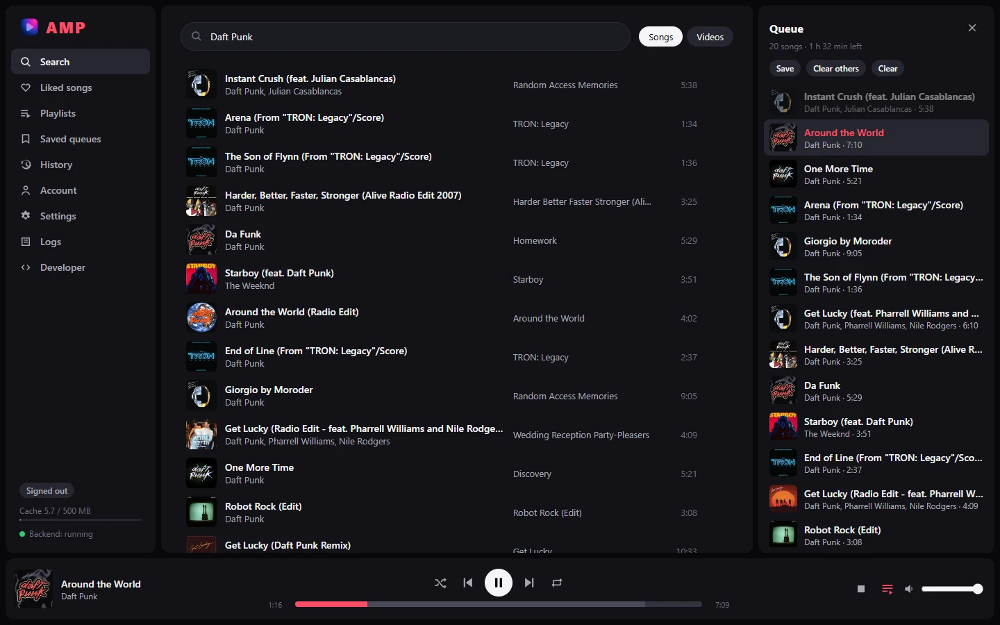

<div align="center">
  
  <h1>
    AMP <br/>
  </h1>
  <i>Another Music Player : a local music player based on Youtube Music library.</i>
  <br/>
  <br/>
  <div>
    <a href="https://github.com/Alxiice/AMP/actions/workflows/python-ci.yml"></a>
    <a href="https://codecov.io/gh/Alxiice/AMP"></a>
    <a href="https://github.com/Alxiice/AMP/actions/workflows/tauri-build.yml"></a>
    <a href="https://Alxiice.github.io/AMP/"></a>
  </div>
</div>

---

AMP is a desktop app that plays music from the YouTube Music library. Songs are downloaded in
small segments and cached on disk, so playback starts fast and you can seek right away. Search and
playback work without an account; signing in with YouTube adds your liked songs and playlists.

<p align="center">
  
</p>

- **Fast playback**: ~10 s segments, cached songs start in about 24 ms, seek anywhere at once
- **Queue** with drag and drop, shuffle and restore, repeat, saved queues; restored on restart
- **Your library**: liked songs and playlists after an optional YouTube sign-in
- **Listening history** with the share of each song you actually heard
- **Settings**: dark, light or system theme, any accent colour, crossfade, volume normalization
- **OBS now-playing widget** on its own local port, for streamers
- **Developer tools**: a Developer page in the app and the `app.py` launcher

<p align="center">
  
</p>

## Requirements

- **Python** 3.10 or newer
- **Node.js** 18 or newer, on your `PATH`. AMP needs it at runtime too, not just to build.
- **Rust** toolchain ([rustup.rs](https://rustup.rs))

## Launch the app

From the repository root:

```bash
cd amp
python -m venv venv
venv\Scripts\activate              # Linux/macOS: source venv/bin/activate
pip install -r requirements.lock
python scripts/build_sidecar.py    # first time only

cd frontend
npm install
npm run tauri dev
```

The AMP window opens. The first run takes a few minutes while Rust compiles. The app starts its
own backend and stops it when you close the window.

Later launches only need the last command:

```bash
cd amp/frontend
npm run tauri dev
```

On Windows you can also double-click `AMP.bat` at the repository root, which runs the same command.

## Download

Ready-made builds for Windows, macOS and Linux are on the
[Releases page](https://github.com/Alxiice/AMP/releases). You still need Node.js on your `PATH`
to play songs.

## Build it yourself

All builds go through one script, run from `amp/` with the venv active. It builds the backend
executable, then the Tauri app, and copies everything into a `build/` folder at the repository
root:

```bash
cd amp
python scripts/build_release.py              # executable + every installer for this system
python scripts/build_release.py --exe-only   # just the executable, no installer
```

What you get in `build/`:

| Path | What |
|---|---|
| `AMP-1.0.0-<os>-<arch>/` | `AMP[.exe]` and `amp-backend[.exe]`. Keep them together; run `AMP` to start. Nothing to install. |
| `AMP-1.0.0-<os>-<arch>.zip` / `.tar.gz` | the same folder, archived |
| `installers/` | `.msi` and `-setup.exe` on Windows, `.dmg` on macOS, `.deb` and `.AppImage` on Linux |

Pick installer types with `--bundles`, e.g. `--bundles deb,appimage` or `--bundles nsis`.
Add `--smoke` to start the backend executable once and check that it works before packaging.

Tauri only builds for the system it runs on, so a Windows machine makes Windows builds, and so on.

### Making a release

The [Release workflow](.github/workflows/release.yml) builds on Windows, macOS and Linux with the
same script. To publish a version:

1. Set the version in `amp/frontend/src-tauri/tauri.conf.json`, `Cargo.toml` and `package.json`,
   and add an entry to [CHANGELOG.md](CHANGELOG.md) (it becomes the release notes).
2. Commit, then tag and push: `git tag v1.0.0 && git push origin v1.0.0`.
3. When the workflow is done, a draft release with all the files is waiting on GitHub. Check it
   and publish it.

## Documentation

The full documentation (usage guide and code reference) is available on **GitHub Pages**:

📚 **[https://Alxiice.github.io/AMP/](https://Alxiice.github.io/AMP/)**

The docs are built with MkDocs from the `docs/` directory in this repository. To build and
preview them locally:

```bash
pip install -r docs/requirements.txt
mkdocs serve                       # then open http://127.0.0.1:8000
```

| | |
|---|---|
| [Install & launch](https://Alxiice.github.io/AMP/usage/install/) | prerequisites, setup, installers, updating yt-dlp |
| [Using the app](https://Alxiice.github.io/AMP/usage/using-the-app/) | search, player, queue, history, settings, Developer page |
| [OBS widget](https://Alxiice.github.io/AMP/usage/obs-widget/) | show the current song on stream |
| [Developer launcher](https://Alxiice.github.io/AMP/usage/launcher/) | `app.py`: run and inspect the backend and frontend |
| [Troubleshooting](https://Alxiice.github.io/AMP/usage/troubleshooting/) | when a song won't play, the app won't start… |
| [Code](https://Alxiice.github.io/AMP/code/) | architecture, backend, frontend, tests, CI |

## License

AMP is released under the [MIT License](LICENSE). It comes with no warranty, and the authors
aren't liable for how it's used. AMP isn't affiliated with YouTube or Google, and downloading from
YouTube with yt-dlp may go against YouTube's Terms of Service: using it is your responsibility.
See [LICENSE](LICENSE) for the full text.
