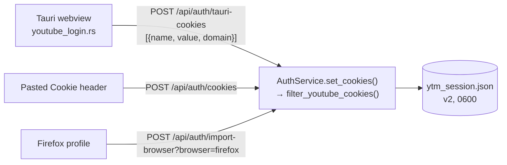
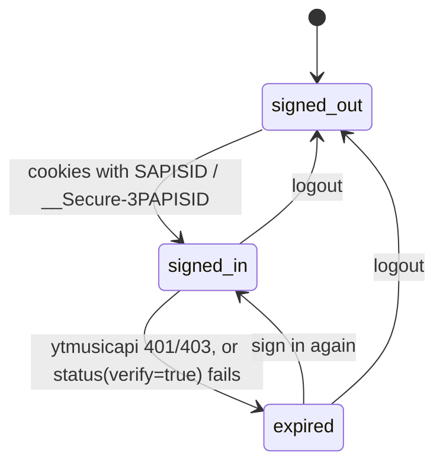

# Authentication

YouTube sign-in is **optional**. Search and playback work signed out; cookies only unlock the
user's library, plus the songs YouTube won't serve anonymously. OAuth doesn't work for YouTube
Music any more, so AMP uses the browser session cookies.

Code: `services/auth.py` (`AuthService`, `CredentialStore`, helpers), `api/auth_routes.py`,
`frontend/src-tauri/src/youtube_login.rs`, `frontend/src/pages/Auth.tsx`, `frontend/src/authSession.ts`.

## Sign-in paths



Every path ends in `AuthService.set_cookies()`, which **filters first**: only cookies whose
domain is `youtube.com` or a subdomain are kept, one per `(name, domain)`.

### 1. Tauri webview (primary)

`youtube_login` (Rust, `async`: reading webview cookies from a sync command deadlocks on Windows):

1. Opens an **incognito** window (480×760) on
   `accounts.google.com/ServiceLogin?service=youtube&continue=https://music.youtube.com/`, with a
   desktop Chrome user agent (Google refuses some embedded browsers).
2. Every 800 ms, reads the cookies of `music.youtube.com` and waits for `__Secure-3PAPISID`.
3. Then waits 1.5 s for the redirect chain to finish, reads the cookies of **both**
   `music.youtube.com` and `www.youtube.com` (merged by name and domain), closes the window and
   returns them.
4. Closing the window → `"cancelled"`; after 10 minutes → `"timeout"`.

The frontend (`tauri_auth.ts`) posts the result to `/api/auth/tauri-cookies`.

### 2. Pasted Cookie header

A `Cookie:` header has no domains, so every cookie gets `.youtube.com`.

### 3. Firefox import

`yt_dlp.cookies.extract_cookies_from_browser("firefox")` reads the profile's `cookies.sqlite`
directly, with no network request. Firefox must be closed (the database is locked while it runs;
the error carries a hint). Other browsers get a 400: Chrome, Edge and Brave use app-bound
encryption on Windows, which other programs can't decrypt.

## Credential store

`CredentialStore` writes `cache/ytm_session.json` atomically (temp file + `os.replace`) with mode
`0600` (not enforced on Windows).

```json
{"version": 2, "cookies": [{"name": "SAPISID", "value": "…", "domain": ".youtube.com"}, …]}
```

Domains are kept because flattening to `{name: value}` loses which site a cookie belongs to, and
another site's `SID` would overwrite YouTube's.

??? info "Migration of v1 files"
    Before v2 the file was a flat `{name: value}`, and an old browser import stored every site's
    cookies in it. When a file without `version` is loaded at startup, `_migrate_v1()`:

    - keeps only an allowlist of 19 YouTube/Google session cookie names (`SID`, `SAPISID`,
      `__Secure-3PAPISID`, `LOGIN_INFO`, …), with domain `.youtube.com`;
    - rewrites the file as v2 and logs `kept N of M cookies` (counts only, never values);
    - if `M > 3·N`, logs a WARNING and reports `migrated_from_full_jar: true` in
      `/api/auth/status` until the next sign-in or logout. The Auth page shows a warning.

## Using the cookies

| Consumer | What it gets |
|---|---|
| ytmusicapi (library calls) | `get_auth_headers()`: `Cookie`, `Origin`/`Referer` music.youtube.com, and `Authorization: SAPISIDHASH <ts>_<hash>` |
| googlevideo (segment downloads) | `get_cdn_headers()`: `Cookie` when signed in, nothing when signed out |
| yt-dlp | `write_netscape_cookie_file()`: a temp file in Netscape format, `0600`, each cookie once on its own domain, deleted in a `finally` |

```python
SAPISIDHASH = sha1(f"{ts} {__Secure_3PAPISID} https://music.youtube.com").hexdigest()
```

For the `Cookie` header (`cookies_by_name`), a `.youtube.com` cookie wins over a same-name
cookie on a subdomain.

The `YTMusic` client is built lazily, on the first library call, so launching offline doesn't
look like a failed sign-in.

## States



Only YouTube Music API errors (`youtube.py`) and `status(verify=True)` mark the session expired.
A **googlevideo 403 doesn't**: it means the stream URL's signature expired, which the
[download pipeline](pipeline.md#fetch_segment-one-verified-download) handles by re-extracting.

## Frontend side

- `authSession.ts`: a shared store with the last `/api/auth/status`. Polled every 60 s while the
  backend runs (with an in-flight guard), and refreshed after any 401 from `/api/user/*`
  (`setUserUnauthorizedHandler` in `api.ts`).
- The sidebar badge shows `Signed in`, `Signed out` or `Session expired — reconnect` and links to
  the Auth page.
- Library and Playlists render `SignInPrompt` when signed out or on a 401.
- `mightBeTauri()` (`__TAURI_INTERNALS__` present) decides whether to show the webview button.

!!! note "Never log credentials"
    Cookie values, the `Cookie` header and full googlevideo URLs (they carry signatures) never
    go to the logs. Tests check this for the v1 migration.
