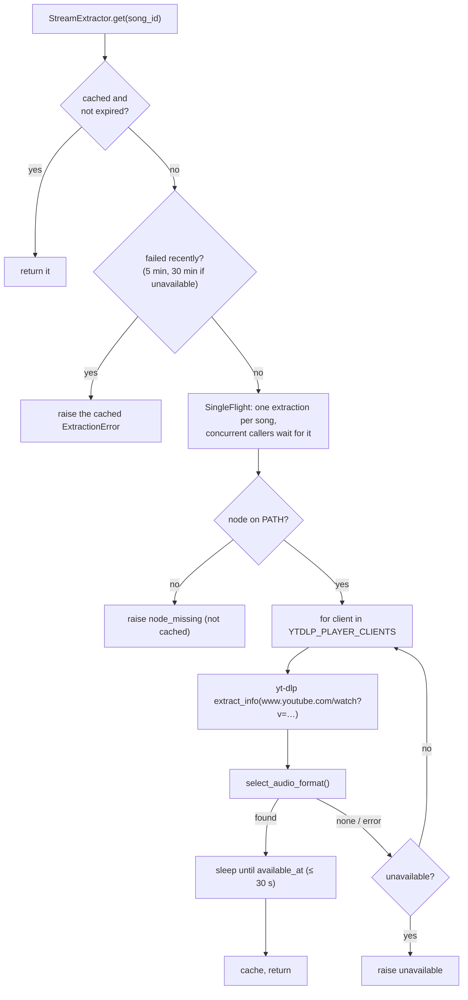

# Stream extraction

`services/extractor.py` turns a song ID into a playable googlevideo URL using yt-dlp. It knows
nothing about segments or FastAPI; `StreamingService` is its only caller and never imports yt-dlp
itself.

## Output: `ExtractedStream`

```python
@dataclass(frozen=True)
class ExtractedStream:
    song_id: str
    url: str              # googlevideo URL: never log it
    itag: str             # "140" normally
    ext: str              # "m4a" | "webm" | "mp4"
    mime_type: str        # "audio/mp4" | "audio/webm"
    acodec: str
    is_audio_only: bool
    filesize: int | None  # format["filesize"], else the URL's clen=
    duration_ms: int      # info["duration"]
    title: str
    expires_at: float     # URL's expire= minus 5 min
    player_client: str    # which client worked (diagnostics)
    available_at: float   # when the URL starts answering (0 = now)
```

It is never written to disk: the URL is signed and expires after a few hours.

## Flow



### Options that yt-dlp actually honours

```python
def build_ydl_opts(player_client, fmt, cookie_file):
    opts = {
        "quiet": True, "no_warnings": True, "skip_download": True, "socket_timeout": 15,
        "js_runtimes": {"node": {}},          # top-level dict
    }
    if player_client:                         # None = yt-dlp's default selection
        opts["extractor_args"] = {"youtube": {"player_client": [player_client]}}
    if fmt:
        opts["format"] = fmt
    if cookie_file:
        opts["cookiefile"] = cookie_file
    return opts
```

!!! danger "yt-dlp silently ignores malformed options"
    `extractor_args` must be `{extractor: {key: [values]}}`. An earlier version passed a list
    (`{"youtube": ["player_client=android"]}`): yt-dlp dropped it without a warning, so the
    client rotation never happened. `test_ydl_opts_player_client_applied` checks the value
    yt-dlp actually sees; keep it.

Each attempt uses `format="bestaudio/best"` with `ignore_no_formats_error=True`, so yt-dlp
returns the full format list instead of raising "Requested format is not available".
The choice is then made in Python.

### Format selection

`select_audio_format(info)` keeps only **audio-only** formats that have a URL, then picks:

1. the itag in `STREAM_FORMAT` (`140`, AAC 128 kbps in MP4) if present;
2. else the best m4a/mp4 audio by bitrate;
3. else the best audio of any container (e.g. `251`, Opus in WebM).

Muxed video (itag 18 = 360p video + audio) is never returned: it would download video for an
audio player. A commented-out fallback in the code shows where to enable it.

### Player clients

`YTDLP_PLAYER_CLIENTS` defaults to `["visionos", "default"]`, one extraction per client.

| Client | Audio-only formats | Delay before the URL works | Time |
|---|---|---|---|
| `visionos` | 139, 140, 249, 250, 251 | none | ~1.0 s |
| `default` (yt-dlp picks; tv_samsung's URL wins) | 139, 140, 249–251 | ~5 s | ~1.8 s |
| `web`, `web_music`, `web_safari`, `tv`, `ios`, `mweb`, `android_vr` | none | | |
| `android` (no PO token) | only muxed itag 18 | | |

*Measured on 2026-10-31 with yt-dlp 2026.10.26, signed out.* Re-measure after a yt-dlp upgrade
if extraction gets slow or fails.

??? info "Cookies and `visionos`"
    `visionos` has `SUPPORTS_COOKIES=False`, and yt-dlp silently drops such a client when a
    cookie file is passed. So the extractor passes cookies only to clients that support them
    (`_client_supports_cookies`) and runs the others anonymously. When signed in, the cookies
    are written to a Netscape-format temp file (mode `0600`) and deleted in a `finally`.

??? info "`available_at`"
    Some clients (the TV ones that yt-dlp's default uses when a JS runtime is available) return
    URLs that answer 403 for a few seconds after extraction. yt-dlp exposes this as
    `available_at`. `wait_until_available()` sleeps until then, capped at 30 s. This is why
    `visionos` comes first.

### Errors

yt-dlp errors are mapped to `ExtractionError.code` by `classify_download_error()`:

| Code | yt-dlp says | Rotation |
|---|---|---|
| `unavailable` | "Video unavailable", "Private video" | stops: no client will help |
| `auth_required` | "Sign in to confirm", age-restricted | tries the next client |
| `no_audio` | formats returned, none audio-only | tries the next client (formats are logged) |
| `extract_failed` | anything else | tries the next client |
| `node_missing` | (checked before running yt-dlp) | |

After all clients fail, the reported code is `auth_required` if any client said so, else
`no_audio`, else `extract_failed`.

## Caching and refresh

| Cache | Size | Lifetime |
|---|---|---|
| streams | `BoundedDict(256)` | until `expires_at` (URL `expire=` − 5 min) |
| failures | `BoundedDict(256)` | 5 min; 30 min for `unavailable`; `node_missing` never cached |

`refresh(song_id, stale_url)` is called when a segment download gets a **403**, which means the
signed URL expired. It runs in the same `SingleFlight`: if the cached URL already differs from
`stale_url`, another worker refreshed it and the new one is returned. So N workers hitting 403
at once cause one re-extraction. If the refreshed stream has a different itag or size, a warning
is logged; the [segment table](segment-table.md#cache-identity-layout_id) handles the change.

`get_extraction_dependencies()` checks `node` on `PATH`, `yt_dlp_ejs` importable and the yt-dlp
version once at startup, logs them and reports them in `/api/health`.

??? note "`SingleFlight` and `BoundedDict`"
    Both are small helpers in `extractor.py`. `SingleFlight.do(key, fn)` runs `fn` once per key
    at a time; concurrent callers block and receive the same result or exception.
    `BoundedDict(maxsize)` is a locked dict that drops its oldest entry beyond `maxsize`, so
    in-memory caches can't grow forever. `StreamingService` reuses both for stream-info building.
