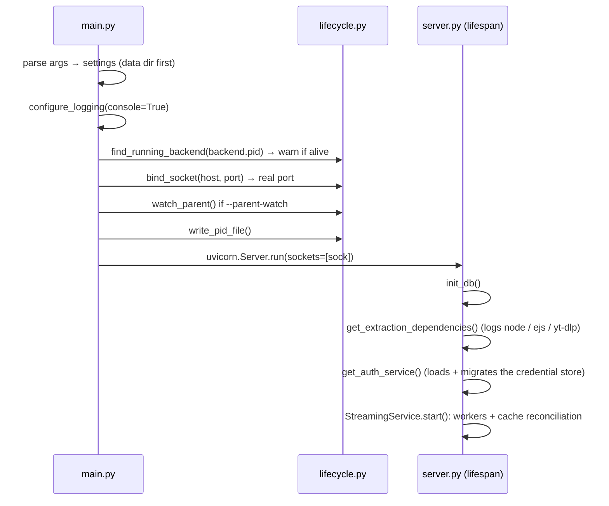

# Backend

A FastAPI server in `amp/backend/`, listening only on `127.0.0.1`. It does four things:

1. **Library**: search and metadata through `ytmusicapi` (`services/youtube.py`).
2. **Account**: stores YouTube cookies and builds auth headers (`services/auth.py`).
3. **Streaming**: turns a YouTube song into a local, seekable audio file made of cached segments
   (`services/extractor.py` + `services/streaming/`).
4. **Logs**: log files, an in-memory ring buffer and a relay for frontend messages.

## Pages

| Page | Topic |
|---|---|
| [HTTP API](api.md) | routes, security middleware, error model |
| [Stream extraction](extraction.md) | yt-dlp → stream URL, single-flight, client rotation |
| [Segment table](segment-table.md) | fMP4 `sidx` parsing, proportional fallback, `layout_id` |
| [Download pipeline](pipeline.md) | segment registry, priorities, workers, retries |
| [Cache & database](cache.md) | segment files, LRU eviction, startup reconciliation, SQLite |
| [Serving & playback](serving.md) | Range endpoint, buffer-ahead, seek, playback session |
| [Authentication](auth.md) | cookies, credential store, sign-in paths |
| [Process lifecycle](lifecycle.md) | entry point, data dir, PID file, parent watch, logging |

## Startup



## Conventions

**Services are thread-safe singletons.** Each module exposes `get_*_service()` (a lock around
lazy construction) and `reset_*_service()` for tests. Never construct a service directly: shared
state (cookies, segment tables, the playback session) lives in the singletons.

```python
_instance: Optional[StreamingService] = None
_lock = threading.Lock()

def get_streaming_service() -> StreamingService:
    global _instance
    with _lock:
        if _instance is None:
            _instance = StreamingService()
        return _instance
```

**Blocking handlers are plain `def`.** Anything that calls `requests`, yt-dlp or touches files
runs in Starlette's thread pool. An `async def` handler doing blocking I/O would freeze the event
loop for every request.

**Settings come from `backend.config.settings`.** A pydantic-settings singleton read from the
environment or `amp/.env` ([list](../../usage/configuration.md#settings)). Computed paths (data
dir, cache, segments, logs, DB file) are private attributes set by `configure_paths()`; tests
redirect them with `configure_paths()` and undo with `snapshot_paths()` / `restore_paths()`.

!!! danger "Never monkeypatch `settings._cache_dir` and friends"
    With pydantic 2.14, `monkeypatch.undo()` *deletes* private attributes instead of restoring
    them, which broke every following test. Use the `temp_dirs` fixture.

## Threads

| Thread(s) | Started by | Job |
|---|---|---|
| Uvicorn event loop | `main.py` | HTTP |
| Starlette thread pool | per request | every `def` handler (extraction, `ensure_segment`, file reads) |
| `DOWNLOAD_WORKERS` (4) workers | `StreamingService.start()` | pop the priority heap, download segments |
| Parent watch (daemon) | `--parent-watch` | read stdin; EOF or `exit` → shutdown |

Shared state is guarded by small locks: the segment registry has one lock, the extractor uses
`SingleFlight` per song, and the play sequence number has its own lock. SQLite is in WAL mode
with `busy_timeout=5000` so workers and handlers can write concurrently.

## Dependencies

| Package | Use |
|---|---|
| `fastapi`, `uvicorn[standard]` | HTTP server |
| `sqlalchemy` | SQLite ORM |
| `pydantic`, `pydantic-settings` | settings, response models |
| `requests` | CDN range downloads |
| `ytmusicapi` | search, metadata, liked songs, playlists |
| `yt-dlp[default]` | stream URLs; the extra pulls in `yt-dlp-ejs` (JS challenge solver, needs Node.js) |

Major versions are capped in `requirements.txt`, except yt-dlp, which must follow YouTube.
`requirements.lock` pins the exact set used by CI and the sidecar.
