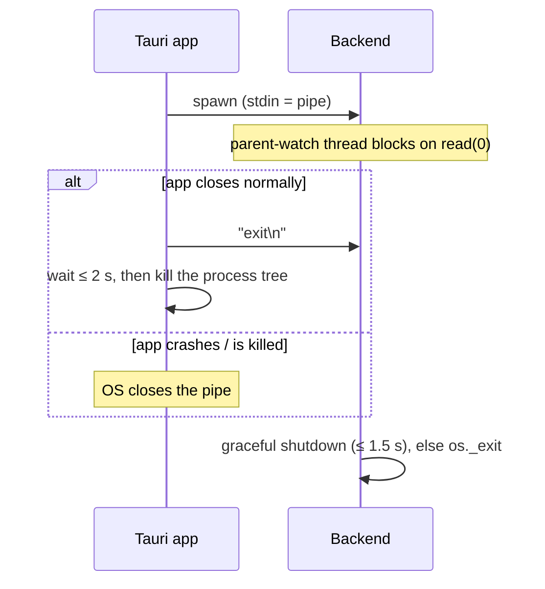

# Process lifecycle

How the backend starts, where it keeps its data, and how it makes sure it never outlives the app.
Code: `main.py`, `lifecycle.py`, `config.py`, `utils/logger.py`. The Rust side is in
[Tauri shell](../frontend/tauri.md).

## Entry point (`main.py`)

```
python -m backend.main [--token T] [--host 127.0.0.1] [--port 8000]
                       [--data-dir DIR] [--parent-watch] [--debug]
```

1. `parse_args` → `apply_args`: CLI values into `settings`. `--data-dir` is applied **first**
   (`configure_paths(data_dir, data_dir/"userdb.sqlite")`), because logging writes under it.
2. `configure_logging(console=True)`.
3. Warn if `backend.pid` names a backend that is still alive.
4. With `--data-dir`, in a checkout: log a hint if the new data dir has no sign-in but
   `amp/.amp/cache/ytm_session.json` exists. Credentials are never copied automatically.
5. `bind_socket()`, then read back the real port (needed for `--port 0`).
6. Create the app, build a `uvicorn.Server` (`timeout_graceful_shutdown=1` so open audio streams
   don't hold up exit).
7. Start the parent watch, write the PID file, `server.run(sockets=[sock])`, remove the PID file
   in a `finally`.

The Tauri app runs it as
`--host 127.0.0.1 --port <free port> --data-dir <app data dir> --parent-watch`.

## Data directory

`Settings.configure_paths(data_dir=None, db_file=None)` decides where everything goes:

| Situation | Data dir | Database |
|---|---|---|
| `--data-dir DIR` (desktop app) | `DIR` | `DIR/userdb.sqlite` |
| from a checkout, no `--data-dir` | `amp/.amp/` | `amp/userdb.sqlite` |
| PyInstaller binary, no `--data-dir` | `config.app_data_dir()`, the same folder as Tauri's | `<that>/userdb.sqlite` |

Under PyInstaller one-file, `__file__` points into a temporary extraction folder wiped at every
launch, so the frozen default must not be relative to the code.

`app_data_dir()` mirrors Tauri's `app_data_dir()` for identifier `com.amp.v2`: `%APPDATA%` on
Windows, `~/Library/Application Support` on macOS, `$XDG_DATA_HOME` or `~/.local/share` on Linux.

## Socket (`lifecycle.bind_socket`)

The backend binds its own socket and hands it to uvicorn:

- the real port is known before startup (PID file, log line), even with `--port 0`;
- on Windows it sets `SO_EXCLUSIVEADDRUSE`, so no other process can bind the same port.
  uvicorn would set `SO_REUSEADDR`, which on Windows allows two listeners on one port.
  On POSIX, `SO_REUSEADDR` is kept (it only affects `TIME_WAIT`).

## PID file

`<data dir>/backend.pid`:

```json
{"pid": 12345, "port": 23850, "started_at": 1793450000}
```

Written atomically at startup, removed on exit if it still names this process.
`find_running_backend()` reads it and probes `http://127.0.0.1:<port>/api/health`: the backend
counts as alive only if the answer has `app: "AMP v2"` **and** the same `pid`. This avoids
mistaking a reused PID, or another program on the port, for AMP. `app.py`'s Force Kill uses the
same check before killing anything.

## Parent watch

With `--parent-watch`, a daemon thread reads file descriptor 0 (raw `os.read`, so it works even
when `sys.stdin` is `None` in frozen builds):

- **EOF** (the parent closed the pipe or died, even killed from the task manager) → shutdown;
- a chunk containing **`exit`** (what the app writes when it closes normally) → shutdown.

Shutdown is `exit_soon()`: set `server.should_exit` (graceful: lifespan shutdown stops the
download workers), and if the process is still alive 1.5 s later, remove the PID file and
`os._exit(0)`.



## Logging (`utils/logger.py`)

`configure_logging()` installs handlers once:

| Handler | Level | Content |
|---|---|---|
| `logs/app.log` | INFO (DEBUG with `--debug`) | everything |
| `logs/streaming.log` | DEBUG | only `backend.services.streaming*`, `backend.services.extractor`, `backend.utils.layout`, `backend.utils.mp4` |
| ring buffer | INFO | last 1000 lines, served by `/api/stream/logs` |
| stderr (`console=True`) | INFO | forwarded by Tauri to the Logs page ("Backend stdout") |

Both files rotate at 5 MB with 3 backups, and are opened lazily (`delay=True`). yt-dlp,
ytmusicapi, urllib3 and httpx are set to WARNING.

The separate `/api/logs` relay (GET/POST/DELETE, 500 lines) holds lines **posted by the
frontend** (load timings, audio errors). It exists because webview `localStorage` is per-origin,
so a server-side relay is the easiest way to see frontend messages from other tools.
