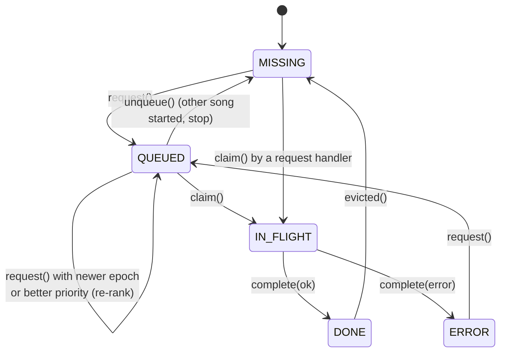

# Download pipeline

How segments get from googlevideo to disk. Three pieces in `services/streaming/`:

| Module | Role |
|---|---|
| `registry.py` | `SegmentRegistry`: the **only** place that knows whether a segment is missing, queued, downloading or done |
| `downloader.py` | `DownloadManager` (priority heap + worker threads) and `fetch_segment()` (one verified HTTP download) |
| `service.py` | glue: `_run_download()` with retries, `ensure_segment()` for request handlers |

## The segment registry

One lock, one entry per `(song_id, index)` key (index `-1` = init segment):



| Method | Behaviour |
|---|---|
| `request(key, priority, epoch)` | no-op if DONE or IN_FLIGHT. Re-ranks a QUEUED entry if the request is from a newer epoch or has a better priority. Queues MISSING / ERROR. Returns whether a heap item must be pushed |
| `claim(key, priority, epoch)` | workers: succeeds only if their heap item is still the current one for that key. Request handlers (no priority): claim anything not DONE / IN_FLIGHT, jumping the queue |
| `complete(key, ok, error)` | IN_FLIGHT → DONE / ERROR, sets a `threading.Event` that wakes waiters |
| `wait(key, timeout)` | block on that event |
| `snapshot(song_id)` | states for `/chunks`, from memory: no filesystem calls |

`/chunks` reports `pending` (MISSING, QUEUED), `downloading` (IN_FLIGHT), `downloaded` (DONE),
`error`.

## Priorities and the heap

```python
class Priority(IntEnum):
    CRITICAL = 0   # init + the segment at the playhead
    HIGH = 1       # the next 2 segments
    NORMAL = 2     # the rest of the ~30 s window
    LOW = 3        # prefetch of the next song
```

The heap is ordered by `(priority, newer epoch first, request order)`. It only holds **hints**:
when a segment is re-ranked, a new item is pushed and the old one stays in the heap. Workers pop
items and call `claim()` with the item's `(priority, epoch)`; a stale item fails the claim and is
skipped. No item is ever removed from the middle of the heap.

The **epoch** is a per-song counter bumped on every seek. Requests made after a seek outrank
everything queued before it. It's a priority, not a cancellation: a segment already downloading
finishes, because its bytes are still valid.

## `fetch_segment()`: one verified download

The robustness-critical path, in `downloader.py`:

1. `GET url` with `Range: bytes=start-end` and the CDN headers (the `Cookie` when signed in).
2. Check the response:
    - status must be **206**: a 200 means the range was ignored, and is **never** saved;
    - `Content-Range` must start with `bytes start-end/`;
    - the byte count must equal `end − start + 1`.
3. Write to a unique temp file `tempfile.mkstemp(dir=song_dir, prefix="NNNN.", suffix=".tmp")`,
   `fsync`, then `atomic_replace()` (`os.replace`, retried briefly on Windows `PermissionError`;
   if an identical-size file already won the race, ours is dropped).

A crash mid-download can't leave a partial file that looks complete, and two writers never share
a temp path.

| Response | Classified as | Handling |
|---|---|---|
| 403 | `_Auth403Error` | the signed URL expired: refresh it **once** and retry |
| 429, 5xx, timeout, short read | `_TransientError` / other | back off 0.5 / 1 / 2 s (+ up to 0.3 s jitter), up to `MAX_RETRIES` attempts |
| 200, other 4xx, Content-Range mismatch | `_PermanentError` | ERROR, no retry |

??? info "403 refresh, in detail"
    `_rebuild_after_403(song_id, stale_url)` runs in the stream-info `SingleFlight`. If the
    cached table's URL already differs from `stale_url`, another worker has rebuilt it and that
    table is reused. Otherwise it calls `StreamExtractor.refresh()` and rebuilds the segment
    table; the layout may change, in which case the [cache identity](segment-table.md#cache-identity-layout_id)
    check purges the old segments. A CDN 403 **doesn't touch the sign-in state**: it means the
    URL expired, not the YouTube session, so the refresh still uses your cookies.

After a successful download: the DB row and the cache size map are updated
(`CacheStore.record_segment`), the key is completed, and `CacheStore.maybe_evict()` runs (O(1)
while under the limit). If the song's `layout_id` changed while the bytes were in flight, the
file is deleted and the key marked ERROR.

## Workers

`DownloadManager.start()` launches `DOWNLOAD_WORKERS` (4) threads. Each loops:

```python
task = queue.get(timeout=1)
if not registry.claim((task.song_id, task.index), task.priority, task.epoch):
    continue                 # superseded, claimed by a handler, or unqueued
handler(task)                # StreamingService._run_download → always completes the key
```

`stop()` pushes one sentinel per worker and shuts the pool down.

## `ensure_segment()`: request handlers

The audio endpoint needs a segment *now*. `StreamingService.ensure_segment(song_id, index)`:

| Registry state | Action |
|---|---|
| DONE (file present) | bump its LRU time, return the path |
| DONE but file gone | mark MISSING, continue below |
| IN_FLIGHT (another thread) | wait on its event, up to `SEGMENT_SYNC_TIMEOUT_S` (15 s) |
| QUEUED / MISSING / ERROR | claim it and download **in this thread**; the queued heap item is skipped later |

On failure or timeout it raises `SegmentUnavailable`. Nothing polls: waiting is always on the
registry's event. Only the thread holding the claim downloads, so a worker and a handler never
fetch the same segment at the same time.

## Who requests what

| Trigger | Requests |
|---|---|
| `/play` | `buffer_plan` from segment 0 at the current epoch; other songs' queued segments are unqueued |
| position report (every 2 s) | `buffer_plan` from the playhead segment, **only** when the playhead entered a new segment |
| `/seek` | bump epoch, `buffer_plan` from the target segment |
| `/resume` | `buffer_plan` from the current segment |
| `/buffer?mode=prefetch` | init + first 2 segments of another song at LOW, session untouched |
| `/stop` | unqueue the song's queued segments (in-flight ones finish) |
| `/audio` | `ensure_segment` for each segment the Range covers |

`buffer_plan(info, start_index, window_ms)` (`playback.py`) returns init + the playhead segment as
CRITICAL, the next two as HIGH, then NORMAL until the window is covered, measured from the
playhead, not the song start.
