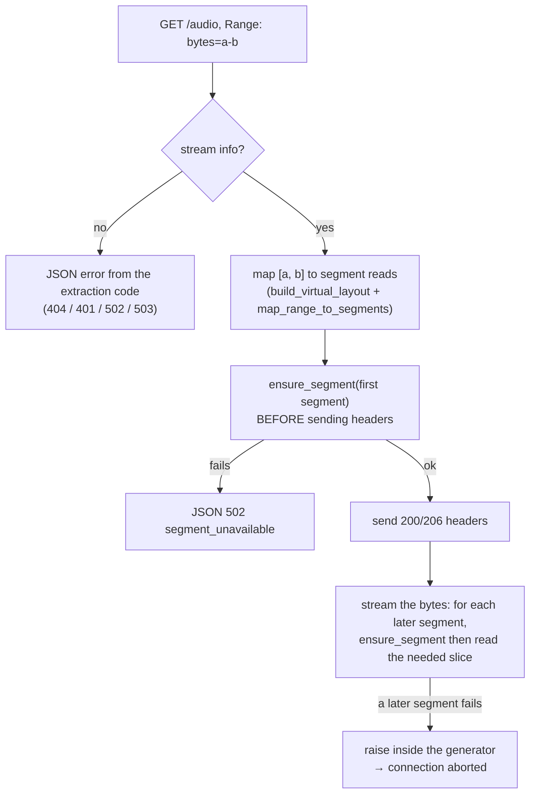

# Serving & playback

## The audio endpoint

`GET /api/stream/{song_id}/audio` is what the `<audio>` element plays. To the browser it's an
ordinary audio file; behind it, `serving.py` assembles the bytes from segment files.

The song is seen as one **virtual file**: `[init][segment 0][segment 1]…[segment N-1]`. With a
sidx table, that virtual file is byte-for-byte the CDN file, so offsets are exact.

### Range support

The browser seeks by sending `Range` requests, so they have to be implemented properly.

| Request | Response |
|---|---|
| no `Range` | `200`, the whole file, `Content-Length: total_bytes` |
| `Range: bytes=a-b` | `206`, `Content-Range: bytes a-b/total`, `Content-Length: b-a+1` |
| `Range: bytes=a-` | `206`, from `a` to the end |
| `Range: bytes=-n` | `206`, the last `n` bytes |
| unsatisfiable | `416`, `Content-Range: bytes */total`, JSON `bad_range` |

Every response carries `Accept-Ranges: bytes`, `Cache-Control: no-cache` and the stream's
`Content-Type` (`audio/mp4` or `audio/webm`).

### How a request is served



Two rules keep the browser from getting corrupt audio:

1. **The first segment is fetched before any header is sent.** If it can't be delivered, the
   response is a JSON error, never a `206` promising bytes that won't come.
2. **A body is never shorter than its `Content-Length`.** If a later segment fails, the generator
   raises and Starlette aborts the connection. The browser sees a network error, which it retries
   (and the [player](../frontend/player.md#error-handling) reloads once). Silently skipping a
   segment would make the HTTP stack fail with a confusing "too little data" error instead.

If a file is evicted between `ensure_segment` and `open`, it's fetched once more. Files are read
in 64 KB chunks, only the slice the range needs. Each served segment gets its LRU time bumped.

The handler is a plain `def`: it blocks in Starlette's thread pool while segments download.

## The playback session

`PlaybackSession` (`playback.py`) holds one `PlaybackInfo` in memory:

```python
song_id, current_segment_index, position_ms, is_playing, volume, epoch, last_updated
```

It isn't persisted: the frontend owns the queue and restores it. The backend only needs to know
which song is playing and where, to decide what to download and what not to evict.

### `/play`

`StreamingService.start_playback(song_id)`:

1. Takes a sequence number (`_play_seq`).
2. **Resolves the stream**: extraction and segment table, blocking on first play. Errors become
   coded JSON responses.
3. If a newer `/play` arrived meanwhile (the user clicked another song), it returns with
   `message: "superseded"` and leaves the session alone.
4. Otherwise it starts the session, **unqueues** other songs' queued segments (in-flight ones
   finish), and queues the buffer plan from segment 0.
5. Returns `{song_id, duration_ms, mime_type, segment_count, is_dash, epoch, cached_ahead}`.
   `cached_ahead` is true when init and segment 0 are already on disk, so playback starts without
   any request to YouTube.

There's no readiness-polling route: when `/play` returns, the stream is resolved and `/audio`
can be requested.

### Position reports and seeks

| Call | Effect |
|---|---|
| `POST /position?position_ms=` (every 2 s) | maps the position to a segment. If it's a **new** segment since the last buffer-ahead (`should_buffer`), queues the buffer plan from it. Otherwise nothing |
| `POST /seek?position_ms=` | bumps the song's **epoch**, maps the position, queues the buffer plan from there with the new epoch: those requests outrank everything queued before |
| `POST /pause` | `is_playing = false` (downloads continue) |
| `POST /resume` | `is_playing = true`, buffer plan from the current segment |
| `POST /stop` | clears the session, unqueues the song's queued segments |

### Buffer plan

```python
def buffer_plan(info, start_index, window_ms):
    # init (if any) + playhead segment → CRITICAL
    # next 2 segments                  → HIGH
    # following segments               → NORMAL, until window_ms past the playhead is covered
```

With `SEGMENT_BUFFER_AHEAD_SEC = 30` and ~10 s segments, that's init + 4–5 segments. The window
is measured from the playhead (accumulating durations from `start_index`), not from the start of
the song.

### Prefetch of the next song

`POST /buffer/{next_id}?mode=prefetch` (sent by the player near the end of a song) resolves the
next song's stream and queues its init and first two segments at **LOW**. The session isn't
touched, so it never competes with the current song. When the next song then gets its `/play`,
those segments are re-ranked to CRITICAL/HIGH if still queued, or already on disk.
