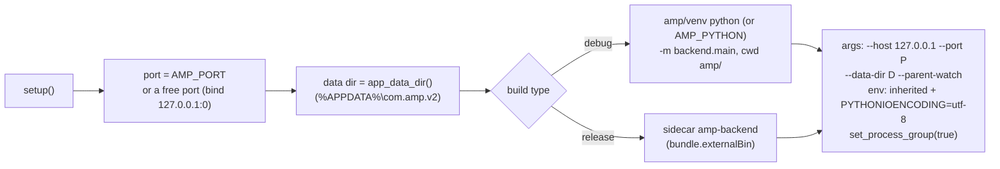

# Tauri shell

The Rust side of the app, in `amp/frontend/src-tauri/`. It's small: it owns the backend process
and the sign-in window. Everything else is the React app.

## `main.rs`

```rust
tauri::Builder::default()
    .plugin(tauri_plugin_single_instance::init(|app, _, _| { /* focus the main window */ }))
    .plugin(tauri_plugin_shell::init())
    .manage(backend::Backend::default())
    .setup(|app| { backend::start(app.handle()); Ok(()) })
    .invoke_handler(generate_handler![
        youtube_login::youtube_login,
        backend::backend_info, backend::backend_logs, backend::restart_backend,
    ])
    // …
    .run(|app, event| if let RunEvent::Exit = event { backend::stop(app) });
```

- **Single instance** (must be the first plugin): a second launch focuses the existing window and
  exits. Two backends on one data dir would each evict files the other serves.
- The **shell plugin** is used from Rust only, to spawn the backend. The webview has no `shell:*`
  permission.

## `backend.rs`: owning the backend

### Spawn



- The environment is **inherited**, so Node.js stays on `PATH` for yt-dlp. `PYTHONIOENCODING` and
  `PYTHONUNBUFFERED` make output UTF-8 and line-buffered.
- `set_process_group(true)` puts the backend in a Windows job object / process group: both the
  venv launcher and the PyInstaller bootloader start a second process, which `kill()` must also
  take down.
- Output lines (stdout and stderr) are decoded with `String::from_utf8_lossy`, kept in a
  1000-line ring and emitted as `backend-log` events. When the current backend terminates,
  `backend-status {state: "stopped", code}` is emitted. A generation counter ignores events from
  a backend that was already replaced by a restart.
- Spawn failures (no venv, missing sidecar) are stored and returned by `backend_info`, and logged
  to the ring so the Logs page shows them.

### Commands

| Command | Returns |
|---|---|
| `backend_info()` | `{port, token}`; `token` is always `null` (the API runs in open mode) |
| `backend_logs()` | the lines logged so far, including those from before the frontend subscribed |
| `restart_backend()` | stop, start, new `backend_info` (the port may change) |

### Stop

On `RunEvent::Exit`: write `exit\n` to the backend's stdin, wait up to 2 s for it to terminate,
then kill the process tree anyway (a PyInstaller/venv child may still be alive). If the app
crashes instead, the OS closes the stdin pipe and the backend's
[parent watch](../backend/lifecycle.md#parent-watch) shuts it down.

## `youtube_login.rs`: sign-in window

See [Authentication](../backend/auth.md#1-tauri-webview-primary). In short: an incognito
webview on Google's sign-in page, polled every 800 ms for `__Secure-3PAPISID`, then the cookies
of `music.youtube.com` and `www.youtube.com` are returned to the frontend, which posts them to
the backend. 10-minute timeout. The command is `async`: reading webview cookies from a sync
command deadlocks on Windows.

The user agent pretends to be desktop Chrome 125 so that Google accepts the embedded browser.
Update it if Google starts refusing.

## Permissions and CSP

`capabilities/default.json` grants `core:default` only: no shell, no filesystem.

The Content Security Policy, identical in `index.html` and `tauri.conf.json`:

```
default-src 'self';
connect-src 'self' http://127.0.0.1:*;
media-src   'self' http://127.0.0.1:*;
img-src     'self' https://i.ytimg.com https://*.ggpht.com https://lh3.googleusercontent.com data:;
style-src   'self' 'unsafe-inline';
```

- `connect-src` / `media-src` allow any loopback port, because the backend's port is chosen at
  launch. `media-src` is what lets `<audio>` load from the backend.
- `img-src` covers YouTube thumbnails (`lh3.googleusercontent.com` serves YouTube Music's).

If you add a new external resource (fonts, another image host), add it to **both** places.

## Configuration (`tauri.conf.json`)

| Key | Value |
|---|---|
| `identifier` | `com.amp.v2`: also the name of the data folder (the backend's `config.APP_IDENTIFIER` must match) |
| `build.beforeDevCommand` / `devUrl` | `npm run dev`, `http://localhost:1420` |
| `build.beforeBuildCommand` / `frontendDist` | `npm run build`, `../dist` |
| `app.windows[0]` | 1200×800, min 800×600 |
| `bundle.externalBin` | `["binaries/amp-backend"]`; Tauri appends the target triple |
| `bundle.icon` | generated from `icon/logo-square.svg` with `npx tauri icon` |

## Tests

`cargo test` (from `src-tauri/`) runs `free_port_is_bindable`. The rest of the shell is checked by
the smoke run of the release build (see [CI & packaging](../development/ci-packaging.md)).
