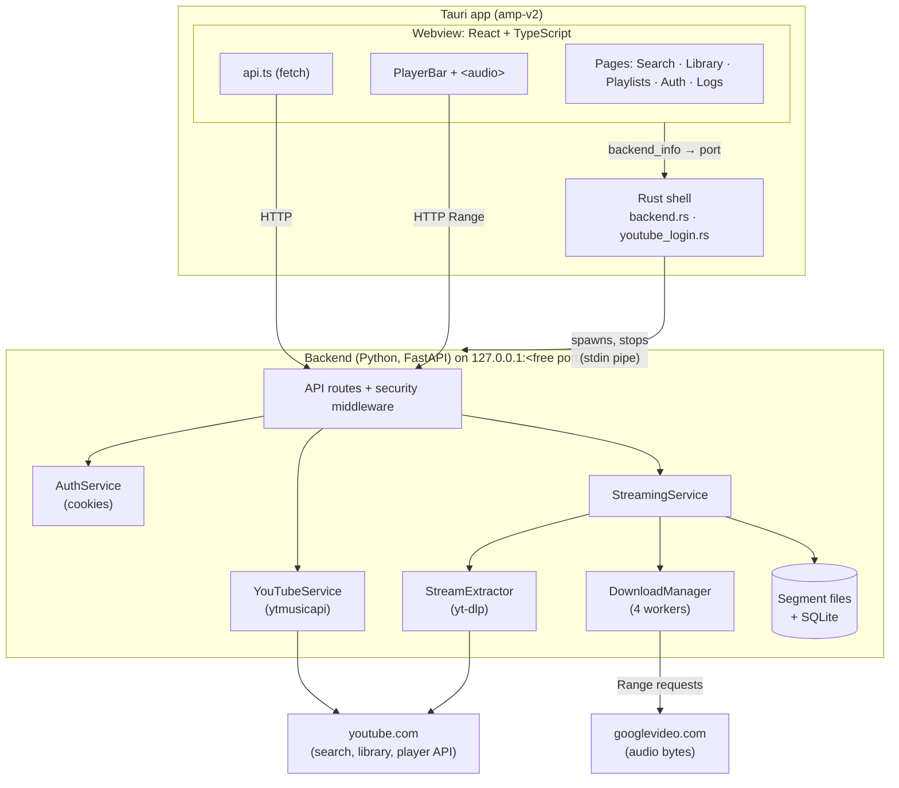
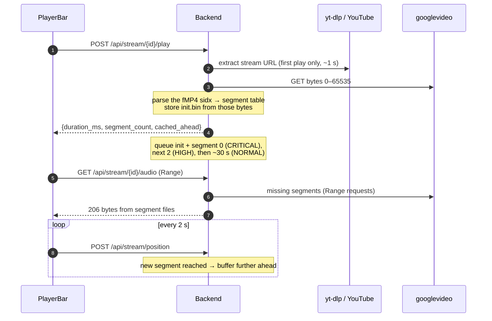

# Code

This section explains how AMP is built, for people who want to change it.

| Page | Covers |
|---|---|
| [Repository layout](layout.md) | where everything is |
| [Backend](backend/index.md) | the Python server: API, extraction, segments, cache, auth, process lifecycle |
| [Frontend](frontend/index.md) | the React app, the player, the Tauri (Rust) shell |
| [Testing](development/testing.md) · [CI & packaging](development/ci-packaging.md) · [Pitfalls](development/pitfalls.md) | working on the code |

## Architecture

Three processes on one machine: the Tauri app (Rust + a webview running React), the Python
backend it starts, and YouTube's servers.

The key idea: **the browser's `<audio>` element never talks to YouTube.** It plays
`http://127.0.0.1:<port>/api/stream/<id>/audio`, a local URL that serves the song as one file
with full HTTP Range support. Behind it, the backend cuts the YouTube file into segments,
downloads them in priority order and keeps them on disk.

## What happens when you press play

1. `/play` blocks until the stream is resolved: the extraction, then the first 64 KB of the
   file, which hold the index ([segment table](backend/segment-table.md)).
2. The player sets `audio.src` only if no newer song was chosen in the meantime
   ([player](frontend/player.md)).
3. The audio endpoint maps the requested byte range to segment files, downloading any that
   are missing on the spot ([serving](backend/serving.md)).
4. Position reports keep the download window about 30 s ahead of the playhead
   ([pipeline](backend/pipeline.md)).

## Stack

| Layer | Technology |
|---|---|
| Shell | Tauri v2 (Rust), system webview (WebView2 / WebKitGTK / WKWebView) |
| UI | React 18, TypeScript, Vite 5, react-router 6 |
| Audio | `HTMLAudioElement`, playing the local Range-capable URL |
| API | FastAPI + Uvicorn |
| Data | SQLAlchemy 2 + SQLite (WAL), segment files on disk |
| YouTube | `ytmusicapi` (search, library), `yt-dlp[default]` + Node.js (stream URLs), `requests` (downloads) |
| Config | `pydantic-settings` (environment / `.env`) |
| Packaging | PyInstaller (backend sidecar), `tauri build` (MSI, NSIS, deb) |
| Quality | pytest, vitest, cargo test, Ruff, GitHub Actions, Codecov |

## Design goals

| Goal | How |
|---|---|
| Fast start | only the init segment and the segment at the playhead are needed to start; they are downloaded first |
| No stalls | 4 workers download ~30 s ahead of the playhead |
| Instant seek | real Range support on the local endpoint; segments are exact (from the file's own index) |
| Persistent cache | segments survive restarts; LRU eviction at 500 MB |
| No setup | open API on loopback, no account needed, backend started by the app |

The cached case meets the < 300 ms target (measured ~25 ms). An uncached song takes about
1.3–1.6 s: the extraction plus one segment.
