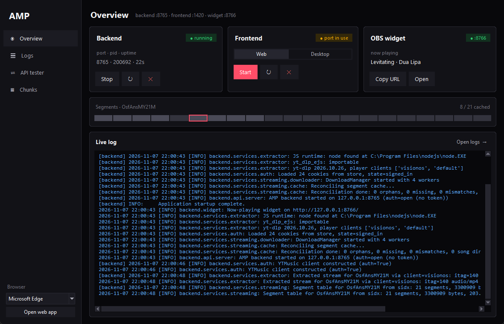
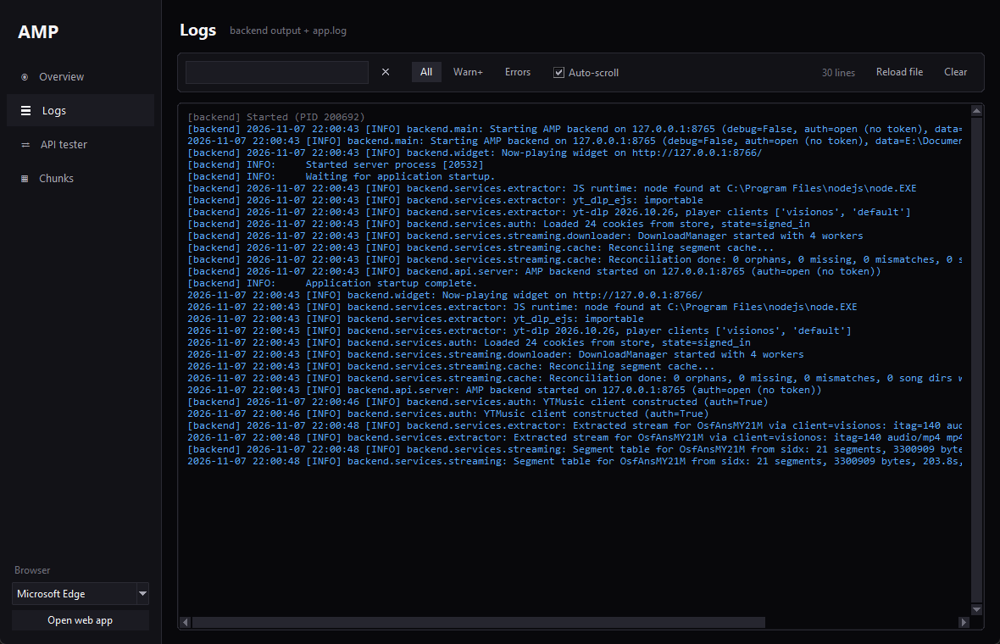
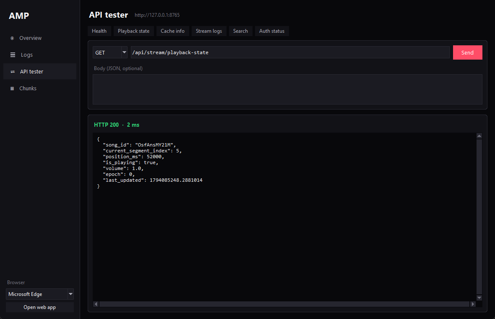

# Developer launcher

`app.py` is a small desktop window for working on AMP itself: it starts and stops the backend and
the frontend, shows their status and logs, and lets you poke the API. It uses only Python's
standard library (tkinter), so it runs from a fresh checkout even when the native app doesn't
build.

```bash
cd amp
python app.py
```

!!! tip "Using AMP, not developing it?"
    You don't need the launcher: the [desktop app](install.md) starts its own backend. Inside the
    app, the **Developer** page shows most of the same information
    ([Using the app → Developer](using-the-app.md#developer)).

{ .screenshot }

## Overview

One card per service, refreshed every 2 seconds. The badge says *running*, *starting*, *port in
use* (something else listens on that port) or *stopped*.

| Card | What it shows | Buttons |
|---|---|---|
| **Backend** | port, process id, uptime | **Start** / **Stop**, ↻ restart, ✕ force kill |
| **Frontend** | *Web* or *Desktop* mode (locked while it runs) | **Start** / **Stop**, ↻ restart, ✕ force kill |
| **OBS widget** | the song the [widget](obs-widget.md) shows, ❚❚ when paused | **Copy URL**, **Open** |

- **Backend** runs `python -m backend.main` on `:8000` (or `AMP_PORT`) with its data in
  `amp/.amp/`. ✕ stops the backend recorded in `amp/.amp/backend.pid`, but only if it still
  answers as that process; otherwise it kills whatever listens on the port.
- **Frontend**, *Web* mode: the Vite dev server on `:1420`, opened in the browser picked at the
  bottom of the sidebar, plus the backend (a browser can't start it). *Desktop* mode:
  `npm run tauri dev`; that app starts **its own** backend with its own data folder.

Below the cards, the **segment strip** shows the song playing in the launcher's backend: grey
segments are on disk, yellow ones are downloading, the outlined one is playing. The **live log**
shows the last 200 lines; **Open logs** goes to the full view.

!!! note "Two backends in Desktop mode"
    The launcher's backend (`:8000`, `amp/.amp/`) and the one the desktop app starts (random port,
    app data folder) don't share cache or sign-in.

## Logs

{ .screenshot }

Backend output and `amp/.amp/logs/app.log`, coloured by level. Search highlights matches; the
**All / Warn+ / Errors** chips filter by level. **Reload file** re-reads the end of `app.log`,
**Clear** empties the view (not the file).

## API tester

{ .screenshot }

Send any method, path and JSON body to the backend; the response is pretty-printed with its status
and timing. The quick buttons fill and send common requests (health, playback state, cache info,
stream logs, search, auth status).

## Chunks

The `segments` table from `amp/userdb.sqlite`, refreshed every 2 seconds while the page is open,
filterable by song id: index, status, size, duration, file path and last access per segment.

## Closing the window

Closing the launcher stops the backend and frontend it started. On Windows the title bar follows
the dark theme.
